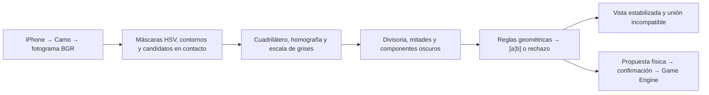

# Visión artificial y reglas de decisión

## Segmentación y geometría

`webcam.py` enumera los dispositivos DirectShow con `list_cameras.ps1`. `live_domino.py` selecciona Camo y entrega el último fotograma disponible. Ambas aplicaciones usan el perfil en vivo y la ruta de `task08a.analyze`. El visualizador habilita además el reintento con compensación de luminancia para lecturas incompletas.

`real_domino.detect_white_faces` genera una máscara verde en HSV de OpenCV y selecciona como cara blanca los píxeles fuera de esa máscara con saturación menor que 90 y valor mayor que 150. Aplica cierre de 5 × 5 y rellena las regiones delimitadas. El filtro de contornos utiliza el rectángulo de área mínima. `domino_chain_vision.py` genera hipótesis adicionales para caras en contacto mediante dimensiones, apoyo de bordes, blancura y divisoria candidata. La puntuación, el solapamiento y la ambigüedad limitan la selección. Los contactos por sí solos no determinan el valor de una ficha.

| Característica | Cálculo y uso | Valor del perfil en vivo |
| --- | --- | --- |
| Color de fondo | Intervalo HSV de OpenCV | H 32–90, S 55–255, V 25–255 |
| Tamaño y forma exterior | Área en píxeles, lado largo / corto y área / rectángulo mínimo | 1800–45000 px², 1,65–2,35 y al menos 0,82 |
| Posición y orientación | Vértices del rectángulo mínimo y eje largo | Homografía a 256 × 128 px; centros de las mitades proyectados a cámara para ordenar |
| Divisoria | Máxima fracción de píxeles oscuros por columna dentro de ±10 px del centro | Cobertura al menos 0,45; margen exterior 9 px y exclusión de 8 px a cada lado de la divisoria |
| Fondo de cada mitad | Percentil 75 y fracción de superficie válida clara | Intensidad al menos 120 y fracción al menos 0,80 |
| Área de un punto | Píxeles de un componente / superficie de la mitad | 0,006–0,028; ruido menor de 12 px |
| Forma de un punto | Ancho / alto y circularidad 4πA/P² del contorno | 0,65–1,55 y circularidad al menos 0,65 |
| Centro y caja | Centroide y caja de cada componente conectado | Localización diagnóstica y rechazo de contactos con bordes |

La homografía estabiliza las dimensiones para poder comparar formas. El percentil alto aproxima la cara clara y el umbral relativo ajusta el contraste a la luz local. Los filtros de área y forma separan puntos razonablemente compactos de ruido y manchas. Las cifras son los valores implementados en `config/detection_live.json`, `config/recognition_live.json` y `config/chain_vision.json`. En las hipótesis de contacto, la cobertura blanca mínima es 0,85, la de divisoria 0,50, la puntuación mínima 0,72 y la IoU máxima 0,12. Falta documentar una justificación experimental independiente de los umbrales y de la resolución espacial del montaje definitivo.

## Árbol implementado

1. Rectificar el cuadrilátero y buscar la columna central más oscura. Si la cobertura de la divisoria es inferior al umbral, rechazar la identidad.
2. Para cada mitad, binarizar con `min(125, 0.55 × percentil75)` y calcular componentes con conectividad 8.
3. Para cada componente, en este orden:
   - Área inferior a 12 px → ignorar como ruido.
   - Contacto con el borde → marcar como sospechoso. El código permite una excepción para bandas en perfiles que la habilitan; el perfil en vivo no la habilita.
   - Área relativa fuera del intervalo → sospechoso.
   - Relación de aspecto fuera del intervalo → sospechoso.
   - Circularidad menor que el mínimo → sospechoso.
   - En otro caso → sumar un punto.
4. Si la superficie clara es insuficiente, queda algún componente sospechoso o hay más de seis puntos, invalidar esa mitad. En otro caso, devolver el conteo, incluido cero.
5. Si ambas mitades y la divisoria son válidas, ordenar las mitades en coordenadas de cámara y emitir `[a|b]`. En otro caso, devolver identidad desconocida. La ruta de fichas en contacto utiliza `chain_tile_reader.py` para sus recortes y reintentos; emplea el mismo conteo geométrico de mitades.

El visualizador compara la zona con la lectura anterior y señala contactos incompatibles. El asistente propone una única incorporación a la cadena confirmada o pide revisión cuando hay ambigüedad. El Game Engine comprueba legalidad, calcula puntos y ordena las alternativas con los datos observables de la partida. El cambio de estado exige confirmación humana.
